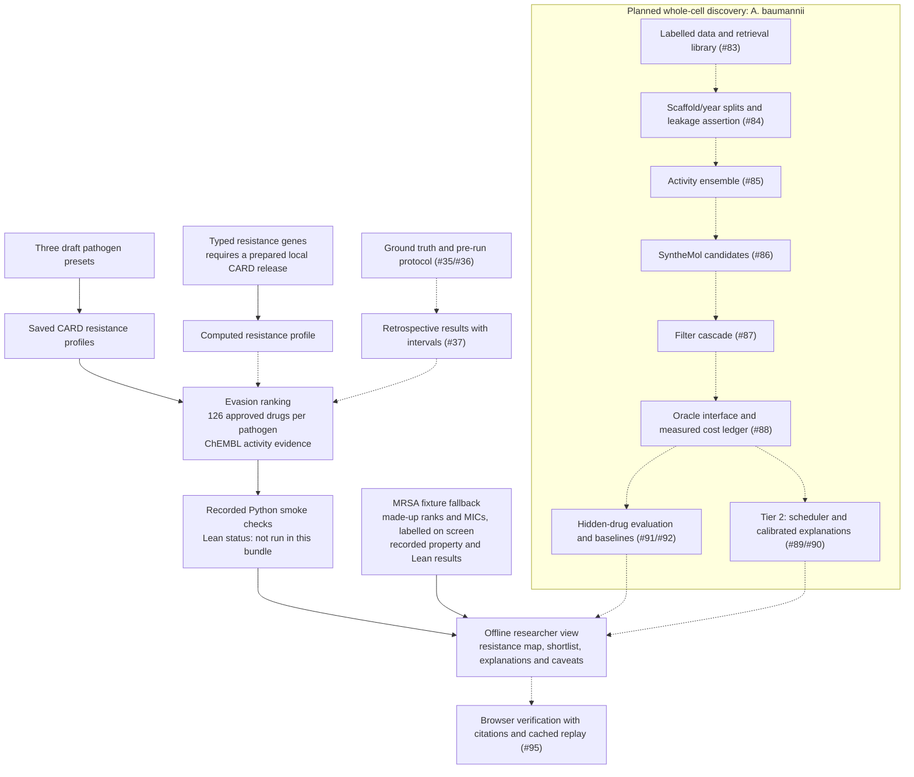

# HTB26-Main

Antibiotic resistance profiling and in-silico candidate prioritisation for Hack The Burgh 2026.

## What it does

Given resistance genes or a pathogen preset, map the determinants to CARD mechanisms
and affected drug classes, then prioritise approved antibiotics with an explanation
and cited evidence. The three chosen pathogens are *Staphylococcus aureus*,
*Klebsiella pneumoniae* and *Acinetobacter baumannii*. All work is computational;
a ranked candidate is not evidence of clinical efficacy or a dosing recommendation.

Two workstreams share the candidate contract: resistance-aware evasion ranking for
the app, and a planned whole-cell discovery pipeline for *A. baumannii*. Generated
proposals will be kept separate from approved drugs.

## Limits

[docs/limits.md](docs/limits.md) is the one page to read before the demo: what the tool does, what it does not claim, and where it is weak, each weakness naming the file or issue that would close it. The short version is that it proposes which approved antibiotics are **not known to be defeated** by an isolate's resistance mechanisms and shows its working — it does not predict that a drug will cure anything, and a computational hit is not a working antibiotic.

## Current state

| Area | Available now | Remaining work |
| --- | --- | --- |
| Resistance data and ranking | CARD-derived profiles and 126 ranked approved drugs per pathogen, with ChEMBL activity evidence, saved in [the integration bundle](docs/pathogen-integration.md) | Preset gene lists are drafts, not measured isolates; typed genes need a prepared CARD release and do not trigger a new ranking in the app |
| Researcher app | Resistance map, explained shortlist, reference crystal previews, property checks and recorded certificate details; [offline fixture and saved-data modes](docs/offline-demo.md) | Browser evidence verification (#95); candidate docking is not connected to these reference previews |
| Property checks | RDKit smoke tests and Lean 4 certificate support | Lean was not run for the saved real rankings; property limits are descriptive, not a safety or activity test |
| Retrospective evaluation | [Cited ground truth](docs/ground-truth.md) and [protocol preparation](results/ws5_retrospective/protocol.md) | Freeze on the evaluation machine before scoring, then run and publish results (#37); no antibiotic validation metrics are available |
| Whole-cell discovery | Data and leakage-control implementation is in PR #101 (#83/#84) | Activity ensemble, generation, filters, cost ledger and hidden-drug evaluation; see the plan below |

The older human-disease network ranking and its results remain as reusable
infrastructure and historical experiments. They do not validate the antibiotic
ranking. The disease UI is disabled unless `VITE_DISEASE_FLOW=1` at build time.

## Run the offline demo

Prepare dependencies and build once while online, then launch:

```sh
./deploy/offline-demo.sh
```

This opens the saved MRSA fixture path. Scores, MICs and ranks are visibly labelled
as made up; recorded property checks and Lean results are identified separately.
To browse the real saved rankings for all three draft presets instead:

```sh
OFFLINE_RESISTANCE=saved ./deploy/offline-demo.sh
```

Both modes run without external services at runtime. Saved mode replays the #34
run; it does not compute fresh rankings. See [setup and walkthrough](docs/offline-demo.md)
for preparation, limitations and browser verification commands.

## Tasks and decisions

[scope.md](scope.md) describes the rationale and workstreams; [tasks.md](tasks.md)
tracks implementation and the cut line recorded on 8 November 2026. The chosen
pathogens, the separate *A. baumannii* whole-cell lane, SyntheMol generation and
Wordsmith browser verification were recorded in decisions #4, #5 and #82.

The next work is to publish an honest evaluation, finish the whole-cell pipeline
in dependency order, and add cited browser verification. The intended whole-cell
sequence is data (#83) → leakage controls (#84) → activity ensemble (#85) →
generation/filtering (#86/#87) → measured oracle costs (#88) → hidden-drug tests
(#91/#92). The scheduler (#89) and calibration/SHAP (#90) are Tier 2. Wild-type
versus mutant docking (#45), resistance-risk scoring (#44), advanced oracles
(#93/#94) and graph proofs (#49) are beyond the recorded 10-hour cut line.

## Pipeline

Solid arrows show the available saved-data demo path. Dashed arrows show planned
connections and work; the discovery lane is not yet an end-to-end implementation.



The dashed link from computed profiles to ranking is pending app integration.
[THIRD_PARTY_NOTICES.md](THIRD_PARTY_NOTICES.md) records reused code and data sources.

## Sponsor integrations

All optional; the app runs on fixtures without any of them. Which of these are actually proven, and how the project meets the HRT and G-Research tracks, is in [docs/sponsor-mapping.md](docs/sponsor-mapping.md).

| Integration | Use | Setup |
|---|---|---|
| Google Gemini | A juror in the Model jury | `HTB_JURY=providers`, `GEMINI_API_KEY`, and a `gemini:<model>` entry in `JURY_MODELS` |
| Vultr | Serverless Inference as a juror, and a VM to host the app | [deploy/vultr/](deploy/vultr/README.md) |
| Tiger Data | Postgres for experiments, jobs and docking results | Set `DATABASE_URL`, then `uv run deploy/db/migrate.py` |
| Entire | Version control for AI-written changes | Below |

**Model jury across providers.** `HTB_JURY=providers` runs three jurors from three
families, each model ID prefixed with its provider (`gemini:`, `vultr:` or `cortex:`),
so one jury can mix Gemini, a Vultr-hosted model and a Snowflake Cortex model.
Only the providers you name need credentials. Example:

```
HTB_JURY=providers
JURY_MODELS='["gemini:gemini-2.5-pro","vultr:<vultr model id>","cortex:claude-sonnet-5"]'
GEMINI_API_KEY=...
VULTR_INFERENCE_API_KEY=...
```

Replies from every provider go through the same validation, so a model that returns
a malformed review is marked invalid, not trusted. The Gemini and Vultr clients have
unit tests with fakes, and have not been run against the live services yet.
Paid calls share the existing `HTB_CORTEX_CALLS_PER_MINUTE` and `_PER_DAY` budget.

**Tiger Data.** The app uses plain Postgres (no extensions), so a Tiger Cloud service
works as is: create a service, copy its connection string into `DATABASE_URL`, set
`HTB_REPO=postgres`, and migrate. Nothing here uses Timescale features yet.

**Entire.** Entire records AI coding sessions alongside your commits. It is a CLI,
not a dependency of the app. Install it, then enable it inside this repository:

```
brew install --cask entireio/tap/entire     # note --cask; or: curl -fsSL https://entire.com/install.sh | bash
entire enable                               # pick your agents; installs agent and git hooks
entire status
```

Session data goes to a separate `entire/checkpoints/v1` branch; `entire doctor` helps
if something is stuck. Details: [github.com/entireio/cli](https://github.com/entireio/cli).
Nothing is committed for it on this branch.

For candidate-specific predicted 3D complexes, see the [Boltz-2 setup and visualization guide](docs/boltz.md).
