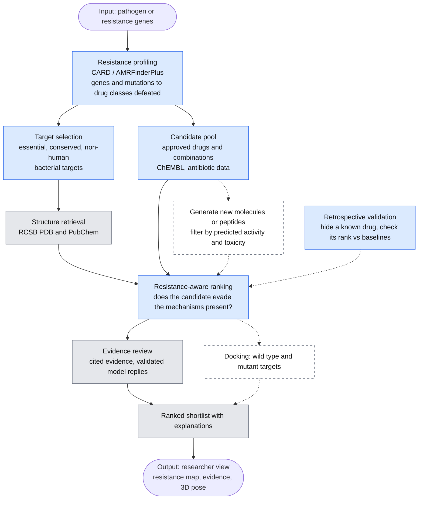

# HTB26-Main
The official repository for Hack The Burgh 2026

# Idea
Bacteria are evolving resistance faster than new antibiotics are approved. Given a resistant bacterium, we profile *why* it is resistant (resistance genes and mutations, via CARD), then rank approved drugs, combinations and (stretch) newly generated molecules that are predicted to evade those mechanisms. Each candidate is smoke-tested against property and toxicity rules (with Lean 4 certificates) and comes with the evidence behind it. Everything is in silico: no wet-lab, human or organism testing.

We check the ranking retrospectively: hide a drug known to work against a resistance profile and see where the method ranks it against simple baselines.

# Limits

[docs/limits.md](docs/limits.md) states what the tool does, what it does not claim, and where it is weak — read it before the demo. In short: it proposes which approved antibiotics are **not known to be defeated** by an isolate's resistance mechanisms, and shows its working. It does not predict that a drug will cure anything.

Two things to know up front: the ranking has **not yet been validated** against known outcomes (#35, #36, #37 are open, and `results/` holds only the earlier project's experiments), and the shortlist the app currently shows is **fixture data** rather than a ranking computed from the profile on screen (#34). A computational hit is not a working antibiotic.

# Tasks
The plan is in [scope.md](scope.md) (what we are building and why) and [tasks.md](tasks.md) (who does what, by phase). Both record the decisions made so far, including the target disease and the in-silico guardrails.

# Pipeline

Blue boxes are new work. Grey boxes are reused code already in the repo (see [THIRD_PARTY_NOTICES.md](THIRD_PARTY_NOTICES.md)). Dashed boxes are stretch goals. Details and scope are in [scope.md](scope.md).

