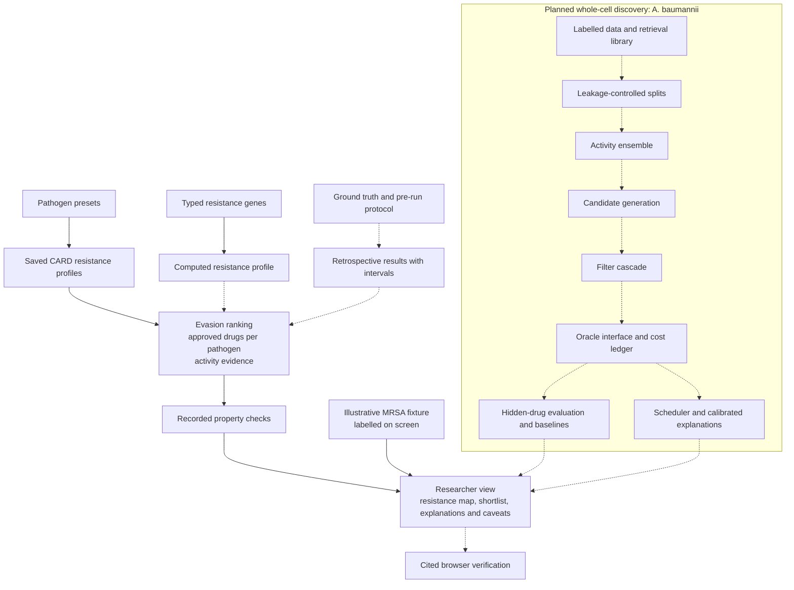

# NovaBiotech

**Resistance-aware antibiotic prioritisation: which approved drugs are still worth trying against a resistant bacterium, and why.**

Built for Hack The Burgh 2026.

## The problem

Antibiotic resistance is a slow-moving pandemic, and the drugs we rely on are running out faster than they are being replaced.

- Bacterial antimicrobial resistance (AMR) was directly responsible for an estimated **1.14 million deaths in 2021** and associated with **4.71 million**. The Lancet's Global Burden of Disease forecast puts the toll at **39 million direct deaths between 2025 and 2050** ([Lancet GRAM study, via Oxford Population Health](https://www.ndm.ox.ac.uk/news/antibiotic-resistance-could-cause-39-million-deaths-between-now-and-2050)).
- The WHO's 2024 priority list places carbapenem-resistant *Acinetobacter baumannii* and carbapenem-resistant Enterobacterales, which includes *Klebsiella pneumoniae*, in its **critical** tier ([WHO Bacterial Priority Pathogens List 2024](https://www.news-medical.net/news/20240520/WHO-updates-Bacterial-Priority-Pathogens-List-to-combat-antimicrobial-resistance.aspx)).
- The pipeline is thin and shrinking. WHO counts **90 antibacterials in clinical development, down from 97 in 2023**, and only **15** are considered innovative. Just 17 new agents against priority pathogens have been approved since 2017, and only two are a genuinely new chemical class ([WHO, 2025](https://www.who.int/news/item/02-10-2025-who-releases-new-reports-on-new-tests-and-treatments-in-development-for-bacterial-infections)).

New antibiotics take a decade or more to reach patients. In the meantime, clinicians and researchers need a faster way to ask a narrower question: **given what this isolate is resistant to, which drugs we already have are least likely to be defeated?**

## What we built

A researcher-facing tool that takes a pathogen, or a set of resistance genes, and:

1. **Maps resistance.** Resistance determinants are linked to their mechanisms and the drug classes they affect, using the CARD database.
2. **Ranks approved antibiotics.** Each candidate is scored on whether the isolate's mechanisms are known to defeat it, so the shortlist favours drugs that evade the resistance in play.
3. **Shows its working.** Every ranking comes with a plain-language explanation, cited activity evidence and recorded property checks, so a researcher can audit the reasoning rather than trust a black box.

We focus on three high-burden pathogens: *Staphylococcus aureus*, *Klebsiella pneumoniae* and *Acinetobacter baumannii*.

A second, discovery-oriented track extends the same framework towards whole-cell screening for novel *A. baumannii* candidates, with generated molecules kept strictly separate from approved drugs.

## Why it is credible

- **Honest by design.** The tool proposes which drugs are *not known to be defeated*. It does not claim that a drug will cure anything, and nothing here is clinical or dosing advice.
- **Validated against real data.** The ranking rule was pre-registered and tested against measured susceptibility results from over 5,000 isolates. It beats chance overall, and we report plainly where it does not beat a simple drug-and-species baseline.
- **Reproducible and offline-capable.** The demo runs from saved data with no external services, and clearly labels anything illustrative.

## Pipeline

Solid arrows show the working demo path; dashed arrows show planned extensions.

## Impact

Resistance data is abundant; the bottleneck is turning it into a decision a researcher can act on and defend. By making the reasoning transparent and the limits explicit, this tool helps teams narrow a large drug space to a short, evidenced list, and points the way towards finding the next generation of antibiotics.

See [docs/limits.md](docs/limits.md) for a full account of what the tool does and does not claim, and [THIRD_PARTY_NOTICES.md](THIRD_PARTY_NOTICES.md) for data sources and reused code.
